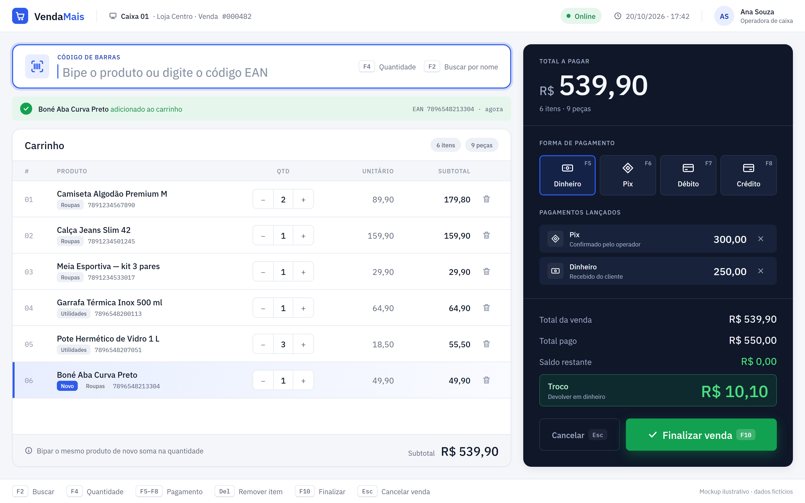

# VendaMais ERP

ERP para varejo com **frente de caixa (PDV)** e **gestão de estoque**, voltado a lojas pequenas (roupas e utilidades). O sistema cobre venda com pagamento misto, leitura contínua de código de barras, entrada de mercadoria por XML de nota fiscal, baixa de produtos avariados e um painel gerencial para o empresário.

> **Status:** em desenvolvimento. O backend tem os contratos da API (controllers, DTOs e Swagger) definidos; a lógica de negócio e o frontend estão sendo implementados pelas issues `PDV-001` a `PDV-008`.

## Frente de caixa



<sub>Mockup de referência para o frontend, com dados fictícios. A fonte editável está em [`docs/mockups/caixa.html`](docs/mockups/caixa.html).</sub>

A tela é pensada para quem atende fila. O operador usa só o leitor e o teclado:

- **Leitura contínua (PDV-005):** o campo de código de barras nunca perde o foco. Bipar o mesmo produto de novo soma na quantidade, e o último item lido fica destacado.
- **Pagamento misto (PDV-006):** cada forma de pagamento entra com seu valor. O saldo restante e o troco são recalculados a cada lançamento, e só existe troco para pagamento em dinheiro.
- **Atalhos de teclado:** `F5` a `F8` escolhem a forma de pagamento, `F10` finaliza e `Esc` cancela.

## Documentação de produto

- [PRD do MVP](docs/prd-vendamais-mvp.md): problema, público, métricas, as 6 histórias de usuário (PDV-001 a PDV-006), o que fica fora desta versão, riscos e decisões já tomadas.

## Stack

| Camada | Tecnologias |
|---|---|
| Backend | Java 21, Spring Boot 4, Spring Data JPA, Spring Security + JWT, Flyway, springdoc-openapi |
| Banco | PostgreSQL 16 (via Docker) |
| Frontend | Angular (em `frontend/`, a criar) |

## Estrutura do repositório

```
open-retail-erp/
├── backend/                  # API Spring Boot
│   ├── mvnw, mvnw.cmd        # Maven Wrapper (não precisa instalar Maven)
│   ├── pom.xml
│   └── src/main/java/com/mega/erp/
│       ├── infra/            # configuração transversal (security, springdoc)
│       └── modules/          # um pacote por domínio
│           ├── sales/        # vendas e pagamentos
│           ├── stock/        # produtos e estoque
│           └── reports/      # relatórios e dashboard
├── frontend/                 # aplicação Angular (a criar)
├── docs/                     # PRD e mockups de tela
├── docker-compose.yaml       # PostgreSQL local
└── .env.example              # variáveis de ambiente
```

Cada módulo segue a mesma divisão interna: `controller/`, `dto/`, `domain/` (enums e entidades) e, conforme for implementado, `service/` e `repository/`.

## Como rodar

### Pré-requisitos

- JDK 21 ou superior
- Docker
- Node.js LTS e Angular CLI (para o frontend)

### 1. Variáveis de ambiente

```bash
cp .env.example .env
```

Edite o `.env` com uma senha de banco e um `JWT_SECRET` próprios. O `.env` não é versionado.

O mesmo `.env` da raiz é lido pelo Docker Compose e pelo backend (o `application.properties` importa `../.env` via `spring.config.import`). Por isso, rode o backend de dentro de `backend/`, que já é o padrão do Maven e da IDE.

O `JWT_SECRET` é obrigatório: sem ele a aplicação não sobe. Gere um valor com, por exemplo, `openssl rand -base64 48`.

### 2. Banco de dados

```bash
docker compose up -d
```

Sobe o PostgreSQL em `localhost:5432`, banco `retail_erp`.

### 3. Backend

```bash
cd backend
./mvnw spring-boot:run      # Linux/macOS/Git Bash
mvnw.cmd spring-boot:run    # Windows (cmd/PowerShell)
```

A API sobe em `http://localhost:8080`.

- Swagger UI: http://localhost:8080/swagger-ui.html
- OpenAPI (JSON): http://localhost:8080/v3/api-docs

Testes:

```bash
./mvnw test
```

Os testes atuais sobem o contexto completo e precisam do PostgreSQL rodando e do `.env` preenchido.

### 4. Frontend

A aplicação Angular será criada em `frontend/`. Ela roda em `http://localhost:4200`, porta já liberada no CORS do backend.

## API

Todas as rotas ficam sob `/api/v1`. O contrato completo está no Swagger.

| Método | Rota | Descrição | Issue |
|---|---|---|---|
| `GET` | `/api/v1/reports/inventory` | Posição de estoque (filtros: `categoria`, `status_estoque`, `page`, `limit`) | PDV-001 |
| `GET` | `/api/v1/reports/sales-summary` | Faturamento, total de vendas e ticket médio por período | PDV-002 |
| `GET` | `/api/v1/reports/slow-moving-products` | Produtos sem venda há X dias | PDV-002 |
| `POST` | `/api/v1/products` | Cadastro de produto | — |
| `GET` | `/api/v1/products/ean/{barcode}` | Busca de produto por código de barras | PDV-005 |
| `POST` | `/api/v1/sales` | Registra venda com pagamento misto (exige header `Idempotency-Key`) | PDV-006 |
| `GET` | `/api/v1/sales/{id}` | Detalhe de uma venda | — |
| `PATCH` | `/api/v1/sales/{id}/status` | Atualiza o status da venda | — |

> Algumas issues de frontend citam rotas antigas (`/api/estoque/relatorio`, `/api/dashboard/resumo`). As rotas válidas são as da tabela acima.

## Como contribuir

### Branches

- `main`: versão estável.
- `develop`: integração. **Toda branch nasce de `develop` e volta por Pull Request.**
- Branches de trabalho: `tipo/descricao-curta`, por exemplo `feat/pdv-001-tela-estoque` ou `fix/validacao-quantidade`.

### Commits

Seguimos [Conventional Commits](https://www.conventionalcommits.org/pt-br/), com escopo opcional:

```
feat(sales): estrutura modulo de vendas
fix(security): remove fallback do JWT_SECRET
docs: atualiza README
chore(setup): configura docker
```

### Issues e Pull Requests

- Cada funcionalidade tem uma issue `PDV-XXX` para backend e outra para frontend.
- Atribua a issue a você antes de começar.
- No PR, referencie a issue (`Closes #N`) e marque os critérios de aceite atendidos.

## Equipe

- [Kauã Henrique](https://github.com/Kaua-Henrique1)
- [Jadson Alves](https://github.com/JadsonAlv3s)
- [marmundo](https://github.com/marmundo)
- [jackssmo](https://github.com/jackssmo)
